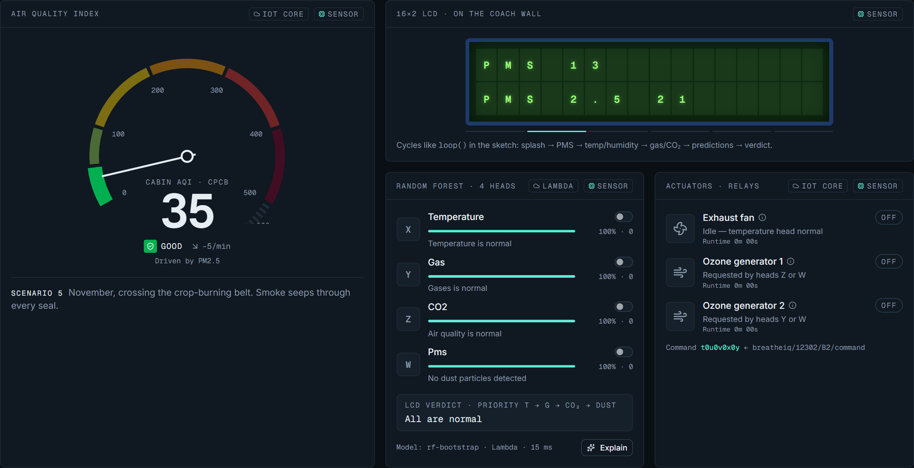
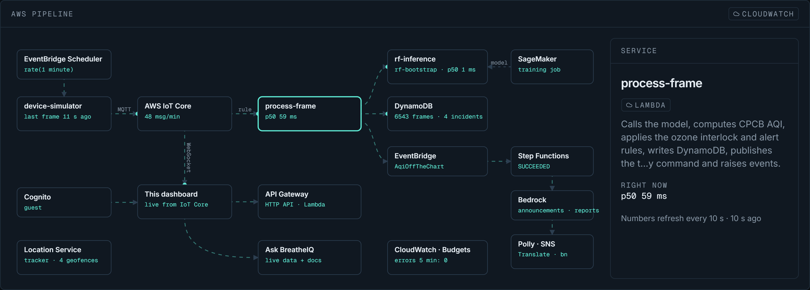
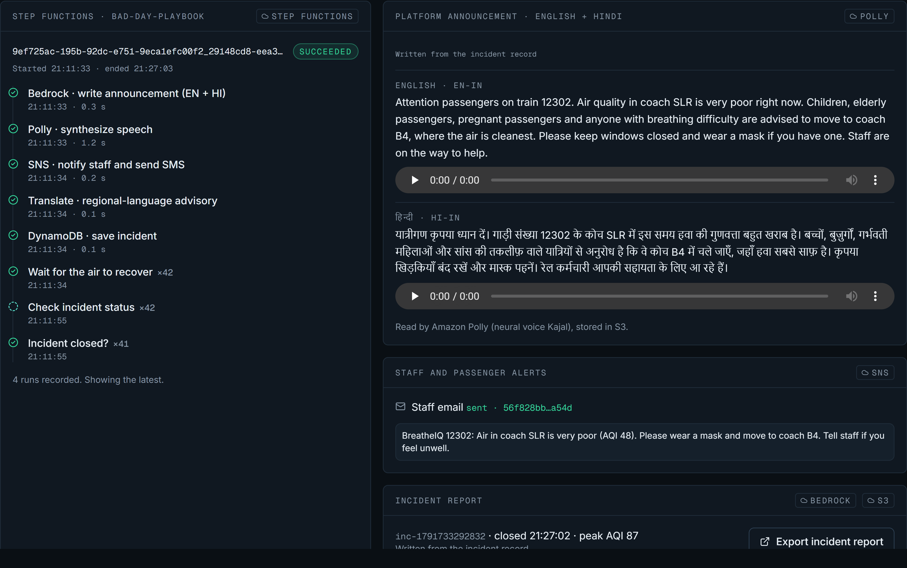
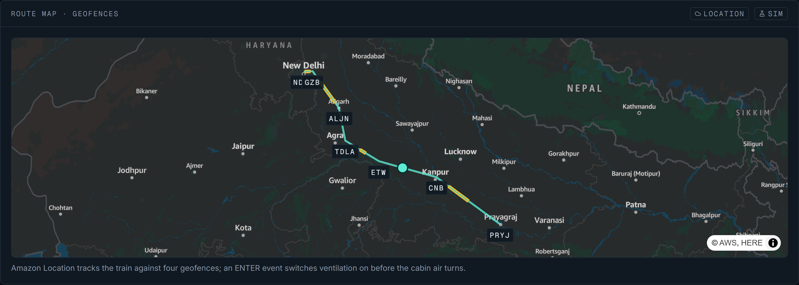

# BreatheIQ

**Breathe easier between stations.** BreatheIQ measures the air inside train coaches, classifies it with a Random-Forest model, switches on ventilation and purification automatically, warns the passengers most at risk, and runs a playbook on the days the AQI goes off the chart. The whole pipeline runs on AWS.

> **Environmental Hacks · Track: Air** — *Pollution, exposure, and the days the AQI goes off the chart.*

| | |
|---|---|
| **Live dashboard** | **https://main.d3abjrsxzx174i.amplifyapp.com** |
| **Presentation (PPT)** | [`docs/BreatheIQ-Team-Purity.pptx`](docs/BreatheIQ-Team-Purity.pptx) |
| **90-second demo script** | [`breatheiq/docs/DEMO_SCRIPT.md`](breatheiq/docs/DEMO_SCRIPT.md) |
| **Every AWS service and why** | [`AWS.md`](AWS.md) |
| **Hardware build and wiring** | [`HARDWARE.md`](HARDWARE.md) |

## Team Purity · Team ID `YGJPRG`

| Member | Role |
|---|---|
| Harsh Yadav | Team leader |
| Samriddhi Ganguly | Member |
| Avishkar Jaiswal | Member |
| Prayag Sharma | Member |

---

## Screenshots

| Live cabin | AWS pipeline (System → Cloud) |
|---|---|
|  |  |
| **Bad-day playbook on AWS Step Functions** | **Fleet route map with pollution-zone geofences** |
|  |  |

---

## The problem

Indian Railways carries close to 2 crore (20 million) passengers a day. Coaches are cramped, turnover at every station is high and ventilation is weak. Air inside a coach can turn bad within minutes:

- **Doors open at crowded platforms** and let in diesel exhaust, dust and heat.
- **Routes cross pollution hotspots**: stubble-burning belts in winter, industrial stretches, tunnels full of brake dust.
- **Packed coaches** push up CO₂, temperature and humidity.
- **Nobody on board knows.** There is no measurement, no warning and no plan for the days the AQI goes off the chart.

The people who suffer most are the ones least able to cope: children, the elderly, people with asthma or COPD, pregnant passengers, and rail staff who spend whole shifts walking through every coach.

## Our answer: three verbs, one for each part of the track

| Track phrase | BreatheIQ | What it does |
|---|---|---|
| **Pollution** | **Track** | Sensors read temperature, humidity, combustible gas and smoke, CO₂ and air-quality gases, and PM1.0 / PM2.5 / PM10 every two seconds. Frames reach **AWS IoT Core**. AQI uses India's CPCB scale and is deliberately **not capped at 500**. |
| **Exposure** | **Warn the most exposed** | Each passenger group gets its own inhaled dose (PM2.5 × minutes × breathing factor) against the WHO 2021 and India NAAQS daily limits, the time left to the limit, and one plain sentence of advice. |
| **The days the AQI goes off the chart** | **Change what happens** | Past AQI 500, **EventBridge** starts a **Step Functions** playbook: ventilation boost, a platform announcement in English and Hindi read aloud by **Amazon Polly**, alerts through **Amazon SNS**, a move to the cleanest coach, and an incident report in **Amazon S3**. |

### Safety first: the ozone interlock

Ozone generators purify air but are harmful to people (CARB and the US EPA both warn against them in occupied spaces). In BreatheIQ the model may *ask* for ozone, but the interlock decides: ozone runs only when the **cabin is unoccupied** *and* estimated ozone stays **under 0.07 ppm (EPA 8-hour limit)**. Otherwise the exhaust fan and filtration run instead, and every decision is logged with its reason.

### Who is most exposed

| Group | Why | Dose factor |
|---|---|---|
| Children (under 12) | Faster breathing, developing lungs | ×1.5 |
| Elderly (65+) | Heart and lung strain | ×1.3 |
| Asthma, COPD | Known respiratory illness | ×1.7 |
| Pregnant passengers | Exposure is linked to low birth weight | ×1.3 |
| Rail staff | 8-hour shifts walking through every coach | ×1.2 |

---

## How it works

### On the coach

```
 DHT11 ───┐
 MQ-2  ───┤                         a{T}b{G}c{C}d{PM}e  (every 2 s)
 MQ-135 ──┼──► Arduino Mega 2560 ─────────────────────────────────► final.py on a PC,
 PMS7003 ─┘          │           ◄─────────────────────────────────  or the dashboard (Web Serial)
                     │                t{X}u{Y}v{Z}x{W}y  (model reply)
                     ├──► relays (active-low): exhaust fan · ozone generator 1 · ozone generator 2
                     ├──► 16×2 LCD on the coach wall
                     └──► Serial1 ──► NodeMCU ESP8266 (Wi-Fi bridge)
```

### On AWS

```
 Coach B2 device ── MQTT breatheiq/12302/B2/telemetry ──► AWS IoT Core
                                                          │ IoT Rule
                                                          ▼
                                   Lambda process-frame ──► Lambda rf-inference (4 Random-Forest heads)
                                     │  CPCB AQI · ozone interlock · alert rules
                                     ├──► DynamoDB (telemetry, coach state, incidents, interlock log, alerts)
                                     ├──► IoT Core command topic (t…y relay command)
                                     ├──► Amazon Location tracker ─► geofence ENTER ─► pre-emptive ventilation
                                     └──► EventBridge "AqiOffTheChart"
                                                 ▼
                         Step Functions bad-day playbook:
                         announcement (EN + HI) → Polly → SNS → Translate → DynamoDB → report → S3

 Dashboard (AWS Amplify) ◄── MQTT over WebSocket (Cognito guest) + API Gateway (IAM) + Ask BreatheIQ (streaming Lambda)
 Amazon Bedrock layer (CDK stack BreatheiqBedrock): announcements, advice, explanations, reports,
                       and the Ask BreatheIQ agent with a Knowledge Base on S3 Vectors and Guardrails
```

On AWS, coach B2's device is a cloud simulator: a Lambda that runs the same engine as the dashboard and publishes a frame every two seconds in the firmware's exact format. The dashboard starts its own engine the moment the page opens and hands over to AWS IoT Core as soon as frames arrive, so it never shows an empty screen; if the network drops it carries on locally. Every generated text also has a written fallback, so the pipeline never stalls on a model call. Service-by-service details: **[AWS.md](AWS.md)**.

### The model

| Head | Input | Switches | Hold-out accuracy |
|---|---|---|---|
| X | Temperature (DHT11) | Exhaust fan | 95% |
| Y | Gas (MQ-2) | Ozone generator 2 | 100% |
| Z | CO₂ (MQ-135) | Ozone generator 1 | 100% |
| W | Dust (PMS7003) | Ozone (via interlock) + LCD alert | 100% |

Each head is a `RandomForestClassifier` (100 trees) trained on `python code/TK172529.xlsx` with an 80/20 split (`random_state=42`), exactly as `python code/final.py` does. The AWS training job ([`infra/training/train.py`](infra/training/train.py)) also exports the forests as plain decision trees, which the `rf-inference` Lambda walks exactly as scikit-learn does: identical predictions on 4,704 test inputs, with millisecond cold starts.

### The dashboard

| # | Page | What it shows |
|---|---|---|
| 01 | Live | AQI gauge, sensor tiles, charts, the coach-wall LCD, the frame console, the four model heads with **Explain**, the relays |
| 02 | Fleet | 12-coach rake by AQI, timetable with haze / tunnel / yard zones, Amazon Location route map, coach × time heat strip |
| 03 | Exposure | Per-group dose against WHO and NAAQS, time to the limit, advice, worst-air ranking, journey receipt |
| 04 | ML Lab | Model card and metrics, what-if with **Explain**, dataset explorer, replay |
| 05 | Controls | Operator sign-in (Cognito), auto / manual relays, the ozone interlock and its log, decision boundaries, alert rules |
| 06 | System | Cloud tab with the live AWS architecture; hardware pipeline, sensor health, connect a real Arduino over Web Serial |
| 07 | Playbook | Bad Day Mode and the real Step Functions run: announcement with audio, alerts, incident report |
| — | Ask BreatheIQ | Press `J` on any page: answers from live coach data and the standards, with sources |

---

## Repository layout

```
.
├── README.md                     you are here
├── AWS.md                        every AWS service and its job
├── HARDWARE.md                   parts, wiring, pins, serial protocol
├── docs/
│   ├── BreatheIQ-Team-Purity.pptx    the presentation
│   └── screenshots/                  images used above
├── ardunio code/                 Arduino Mega firmware
├── python code/                  final.py (serial bridge + 4 Random-Forest heads), TK172529.xlsx
├── breatheiq/                    web dashboard (React 19, TypeScript, Vite, Tailwind CSS v4)
│   ├── src/sim/                  AQI maths, model heads, simulation engine (also runs in the cloud)
│   ├── src/cloud/                AWS IoT source, Cognito credentials, SigV4, API client
│   ├── src/ask/                  Ask BreatheIQ assistant and Knowledge Base documents
│   ├── src/pages/                Live · Fleet · Exposure · ML Lab · Controls · System · Playbook
│   └── docs/DEMO_SCRIPT.md       90-second demo script
├── infra/                        AWS CDK app (TypeScript)
│   ├── lib/                      BreatheiqCore · BreatheiqWeb · BreatheiqBedrock stacks
│   ├── lambda/                   simulator, process-frame, rf-inference, api, chat, playbook, agent actions, geofence
│   └── training/                 training script, data, bootstrap forest
└── scripts/                      deploy, post-deploy config, train, publish, teardown
```

---

## Run it

### 1. Dashboard on your laptop (works offline)

Requirements: **Node.js 20+**.

```bash
cd breatheiq
npm install
npm run dev                          # http://localhost:5173
npm run build && npm run preview     # production build, http://localhost:4173
```

| Key | Action |
|---|---|
| `1`–`7` | Scenario: normal · platform rush · heat wave · smoke/gas · stubble-burning haze · tunnel dust · everything at once |
| `B` | Bad Day Mode |
| `J` | Ask BreatheIQ |
| `P` / `Ctrl+K` | Presenter panel (speed, freeze, reset, cloud simulator on/off) |
| `Space` | Pause / resume |
| `G` | Guided 60-second tour |

### 2. Deploy to AWS

Requirements: AWS CLI credentials (`aws login` or `aws configure`) and Node.js 20+. No Docker needed.

```bash
node scripts/deploy.mjs --profile <aws-profile> --alert-email you@example.com
```

One command bootstraps CDK, deploys the `BreatheiqCore`, `BreatheiqWeb` and `BreatheiqBedrock` stacks, writes the dashboard's `aws-config.json`, stores the route geofences, issues the coach device certificate (kept in SSM, never on disk), uploads the Knowledge Base documents, creates the operator login, runs the training job and publishes the dashboard to Amplify. It prints the live URL at the end. Region: `us-east-1` (`--region` to change). `--skip-train` and `--skip-bedrock` leave out those steps.

- Operator password: `aws ssm get-parameter --name /breatheiq/operator/password --with-decryption --query Parameter.Value --output text`
- Retrain: `node scripts/train.mjs`
- Republish the dashboard after UI changes: `node scripts/publish-web.mjs`

### 3. Tear down

```bash
node scripts/teardown.mjs --profile <aws-profile> --yes
```

### 4. Cost

About **$17–20 a month** with the cloud simulator running around the clock and about **$1–2 a month** with it paused (Presenter panel → Cloud simulator). Nothing has a fixed hourly price: no SageMaker endpoint, no OpenSearch, no NAT gateway. An AWS Budget alerts at 50 % and 100 % of USD 20.

### 5. Real hardware

Wire the parts as in [HARDWARE.md](HARDWARE.md) and flash `ardunio code/sketch_jun21a/sketch_jun21a.ino` to the Arduino Mega. Then either:

- run the Python bridge on a PC: `cd "python code"`, `pip install -r requirements.txt`, set the COM port in `final.py` (`serial.Serial('COM5', ...)`), then `python final.py`. It trains the four heads, answers every frame with the relay command, and uploads each reading to ThingSpeak with the write key in `THINGSPEAK_API_KEY`; or
- open the dashboard in Chrome or Edge → **System → Hardware → Connect real Arduino** to read frames over Web Serial at 115200 baud.

The coach's AWS IoT Core certificate is stored in SSM Parameter Store under `/breatheiq/device/breatheiq-12302-B2/`.

---

## Built with

| Layer | Technology |
|---|---|
| Sensing | DHT11, MQ-2, MQ-135, Plantower PMS7003 |
| Controller | Arduino Mega 2560, 16×2 LCD, 3-channel relay board, NodeMCU ESP8266 |
| ML | scikit-learn `RandomForestClassifier`, SageMaker training script, Lambda inference from exported trees |
| Cloud | AWS CDK, IoT Core, Lambda, DynamoDB, EventBridge, Step Functions, API Gateway, Cognito, Amplify Hosting, CloudWatch, Amazon Location, SSM Parameter Store, AWS Budgets |
| Generative AI | Amazon Bedrock (Converse API, Agents, Knowledge Bases on S3 Vectors, Guardrails), Amazon Polly, Amazon Translate, Amazon SNS |
| Dashboard | React 19, TypeScript, Vite, Tailwind CSS v4, Recharts, Framer Motion, Zustand, MapLibre GL, MQTT.js, Web Serial API |

## Standards referenced

- **CPCB National Air Quality Index** (India): AQI from PM2.5 and PM10 sub-indices
- **WHO Air Quality Guidelines 2021**: PM2.5 15 µg/m³, PM10 45 µg/m³ (24-hour)
- **India NAAQS 2009**: PM2.5 60 µg/m³, PM10 100 µg/m³ (24-hour)
- **US EPA ozone**: 0.07 ppm, 8-hour average (the interlock limit)
- **GB/T 18801-2015**: air purifier performance
- **ASHRAE 41.1 / ISO 7726**: temperature measurement

## Roadmap

- Forward PM2.5 and PM10 in the serial frame (the firmware sends PM1.0 today).
- Occupancy sensing in the coach, so the ozone interlock runs on a measured signal.
- Publish from the ESP8266 straight to AWS IoT Core with the coach certificate.
- One sensor node per coach, feeding the Fleet view.
